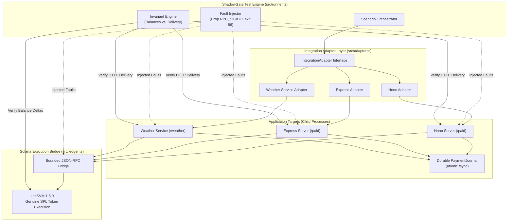

# ShadowGate SVM

**Payment landed. Did the result arrive?**

[](#verified-build--independent-application-verification)
[](https://nodejs.org)
[](https://github.com/LiteSVM/litesvm)
[](LICENSE)

ShadowGate is a local deployment regression gate and automated verification harness for Solana x402 payment integrations. It executes genuine signed SPL token transactions inside an in-memory Solana Virtual Machine (LiteSVM), injects controlled faults at payment-delivery boundaries, and cross-checks ledger balances against the actual HTTP response delivered to the payer.

Its CLI produces deterministic release decisions along with portable **JSON**, **JUnit XML**, and **standalone HTML** evidence reports. Its real-time Mission Control dashboard enables interactive scenario execution, profile comparison, and audit trail inspection.

---

## The Problem: The Payment-to-Delivery Gap

In HTTP 402 micro-payment architectures, two decoupled systems must synchronize:
1. **On-chain settlement**: An irreversible token transfer executed by a Solana facilitator.
2. **Off-chain resource delivery**: An HTTP response delivering the protected digital asset to the payer.

When an unexpected transport disconnection occurs, an RPC node drops a confirmation, or a server process terminates unexpectedly (e.g. exit code 86) immediately after broadcasting a transaction:
- **The customer's wallet is debited on-chain.**
- **The customer receives an HTTP error, 502/504, or transport drop.**
- **Retrying the purchase risks double-debiting the customer.**

ShadowGate enforces an invariant: **Every settled payment must yield exactly one verifiable, authenticated delivery—even across abrupt process restarts, RPC dropouts, and connection failures.**

---

## Architecture Overview



---

## Verified Build & Independent Application Verification

The suite executes a complete **42 / 42 check verification matrix** across three distinct adapters:
1. **Official Hono Fixture** (`src/target.ts`): 14 checks (6 baseline failure checks + 8 recovered checks).
2. **Official Express Fixture** (`src/target.ts`): 14 checks (6 baseline failure checks + 8 recovered checks).
3. **Independent Weather Service** (`integrations/weather/`, pinned to commit [`7f2b2f1`](https://github.com/x402-foundation/x402/tree/7f2b2f1f77fa5317615735e3378a6fad41cccb4e) of the official `x402-foundation/x402` repository): 14 checks (6 baseline failure checks + 8 recovered checks).

```
TOTAL CHECKS: 42
  ├── Baseline Exposure Tests: 18 checks (9 properly failed release gates)
  └── Recovered Invariant Tests: 24 checks (24 passing release gates)
```

- **Baseline Gate Detection**: Confirms that unhardened deployments fail the release gate (`exit 1`) when encountering RPC drops or process crashes.
- **Recovered Gate Verification**: Confirms that durable journal persistence and authenticated recovery pass the release gate (`exit 0`).
- **TypeScript**: `npm run typecheck` passes with zero errors.

---

## Quickstart

### Prerequisites
- **Node.js >= 24.0.0** and npm.
- Linux (x86_64/arm64) or macOS or WSL2 Ubuntu recommended.
- **No external dependencies**: No Solana CLI, wallet keys, faucets, remote RPC tokens, Docker, or real funds required.

### 1. Install & Test

```bash
# Clone and install dependencies
git clone https://github.com/intelliDean/shadowgate.git
cd shadowgate
npm ci

# Run the complete 42-check test suite
npm test
```

### 2. Launch Mission Control Dashboard

```bash
npm run demo
```
Open **http://127.0.0.1:4173** in your browser. Launch comparison runs, inspect ledger balances, explore failure traces, and download audit reports in JSON, HTML, or JUnit XML format.

---

## CLI & Release Gate Commands

ShadowGate provides distinct commands for comprehensive testing and CI deployment gates:

```bash
# Run full comparison matrix across all 3 adapters (Hono, Express, Weather): 42 checks
npm run compare:all

# Release gate for official Hono or Express deployments:
npm run gate -- --profile recovered --adapter hono
npm run gate -- --profile recovered --adapter express

# Release gate for the independent Weather Service:
# 1. Unsafe baseline configuration: fails the gate as expected (exits 1):
npm run gate -- --profile baseline --adapter weather

# 2. Corrected durable recovery: passes all gates (exits 0):
npm run gate -- --profile recovered --adapter weather
# (or convenience shortcut)
npm run gate:weather
```

> **Release Rule**: `compare` exits 0 when every experiment correctly reproduces its stated outcome (including baseline failure detection). `gate` exits 0 **only** when all safety invariants hold and no payments are stranded without delivery.

---

## Scenario Test Matrix

Each test scenario provisions a fresh ephemeral keypair, a distinct SPL token mint, funded payer balances, and an isolated child-process server instance:

| # | Scenario | Baseline Behavior (Default) | Recovered Behavior (ShadowGate) | Gate Invariant Checked |
| :-: | :--- | :--- | :--- | :--- |
| **1** | **Normal payment** | Payment transferred; artifact returned | Payment transferred; artifact returned | HTTP 200, balance debited, artifact matches |
| **2** | **Lost RPC send response** | Payment settles on-chain; client receives 402/timeout | Server reconciles via signature status; returns artifact | No double charge on identical retry |
| **3** | **Prebroadcast failure** | Payment fails before send; no delivery | Client withheld; recovery of prepared record returns 409 | Unpaid prepared journal never releases artifact |
| **4** | **Confirmation failure** | SDK retries confirmTransaction; succeeds | Recovery path remains intact and operational | Graceful recovery under RPC observation lag |
| **5** | **Process crash after send** | Process exits 86; restart has no recovery endpoint (HTTP 404) | Prepared journal persisted before send; payer recovers stored result | Exact artifact identity restored post-crash |
| **6** | **Compute budget policy** | Accepts transactions exceeding sponsor policy | Rejects transaction before broadcast (HTTP 402) | Sponsor compute-unit and priority fee enforcement |
| **7** | **Wrong-payer recovery** | *Not present in baseline* | Replay returns 409; wrong wallet returns 403; rightful payer recovers | Cryptographic Ed25519 payer authorization |
| **8** | **Recovery replay** | *Not present in baseline* | Payer recovers identical artifact 3x without duplicate debit | Single on-chain debit (`executed === 1`) |

---

## Integrating a Custom Application

ShadowGate was designed from the ground up to be decoupled and modular. To integrate an external application, implement the `IntegrationAdapter` interface in [`src/types.ts`](src/types.ts):

```typescript
import type { IntegrationAdapter, DeliveryContext, CaseResponse } from './types.js';

export const myAppAdapter: IntegrationAdapter = {
  name: 'my-service',
  title: 'My Custom Solana x402 Service',
  paidRoute: '/api/v1/resource',
  recoveryRoute: '/api/v1/recover',
  defaultTarget: './path/to/server.ts',

  // Assert that an HTTP response constitutes successful delivery
  isDelivered(response: CaseResponse, context: DeliveryContext): boolean {
    return response.status === 200 && response.body?.data !== undefined;
  },

  // Verify that a recovered artifact matches the original prepared content
  matchesArtifact(recovered: any, oracle: any, context: DeliveryContext): boolean {
    return recovered?.data === oracle?.data;
  },

  // Inspect your persistent storage at the crash boundary
  async inspectJournal(journalPath: string, context: DeliveryContext) {
    // Return entry count and prepared state
    return { prepared: true, entryCount: 1, artifact: { ... } };
  },

  // Create an authenticated recovery request signed by the payer
  async createRecoveryProof(payload: any, payerKeypair: Keypair, context: DeliveryContext) {
    return {
      method: 'POST',
      body: { paymentPayload: payload, signature: '...' }
    };
  }
};
```

Run the gate against your adapter:
```bash
npm run gate -- --profile recovered --adapter ./my-app-adapter.ts --target ./my-app-target.ts
```

For complete protocol and lifecycle specifications, see [docs/INTEGRATION.md](docs/INTEGRATION.md).

---

## Project Structure

```
shadowgate/
├── docs/
│   ├── ARCHITECTURE.md          # Technical design, lifecycle, and failure domains
│   ├── DEMO.md                  # Hackathon video walkthrough script and timing
│   ├── INTEGRATION.md           # Adapter integration specification and IPC contract
│   └── PITCH.md                 # Product value proposition and market context
├── evidence/                    # Test artifacts, BUILD-VERIFICATION.json, and run outputs
├── integrations/
│   └── weather/                 # Independent application integration (x402-foundation example)
│       ├── app.ts               # Upstream weather service (pinned to commit 7f2b2f1)
│       ├── target.ts            # Test harness for baseline and durable recovery
│       └── README.md            # Independent verification documentation
├── src/
│   ├── adapter.ts               # Reusable adapter registry (Hono, Express, Weather)
│   ├── cli.ts                   # CLI entry point (gate, compare)
│   ├── demo.ts                  # Mission Control web dashboard server
│   ├── fixture.ts               # Ephemeral key and SPL token mint provisioning
│   ├── journal.ts               # Atomic fsync payment journal implementation
│   ├── ledger.ts                # LiteSVM Solana runtime & JSON-RPC bridge
│   ├── reports.ts               # Standalone HTML, JSON, and JUnit XML report generators
│   ├── runner.ts                # Scenario orchestrator and invariant verification engine
│   ├── selftest.ts              # 42-check regression test suite
│   └── types.ts                 # Core type definitions and adapter interfaces
├── web/
│   └── index.html               # Mission Control single-page application interface
├── package.json                 # Project scripts and pinned dependencies
└── tsconfig.json                # TypeScript strict configuration
```

---

## Trust Boundaries & Limitations

- **Local Execution**: Uses LiteSVM 1.5.0 in-memory execution with genuine signed SPL tokens. All keys, mints, and lamports are local and valueless.
- **RPC Simulation**: The JSON-RPC bridge reports local execution as confirmed for SDK compatibility. It does not model validator consensus, chain reorganizations, or blockhash expirations.
- **Recovery Reference**: The provided recovery pattern demonstrates atomic single-node file persistence (`fsyncSync`); production high-availability deployments should integrate distributed ACID databases or Redis/PostgreSQL WAL.
- **Audit Scope**: Passing this release gate certifies compliance with the tested failure scenarios and payment-to-delivery invariants; it does not constitute a formal smart contract security audit.

---

## License

MIT © 2026 ShadowGate Contributors. See [LICENSE](LICENSE) for details.
