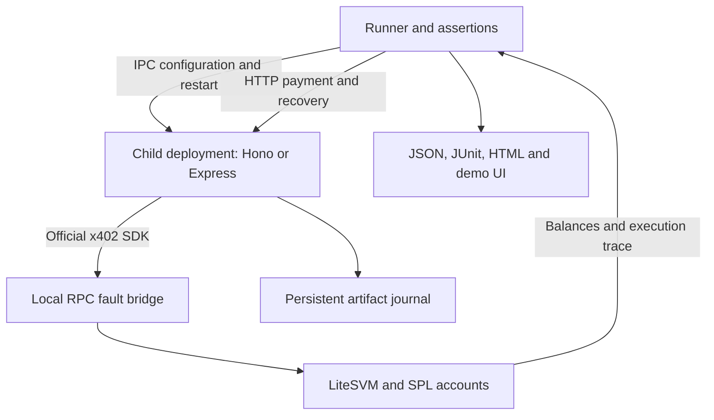

# Architecture

ShadowGate evaluates one concrete boundary: **a payment that actually executes must produce a recoverable result for its payer; an unpaid request must not receive that result**. A separate configured policy bounds the sponsor's cost. Each experiment records what happened and whether it is acceptable for release.

## Execution model

The parent runner creates a fresh LiteSVM instance and real SPL mint and token accounts. It starts a loopback JSON-RPC bridge, then forks a target process. Initialization travels over Node IPC, including temporary keys and deployment configuration. The target starts the resource server and facilitator. The runner acts as the payer through HTTP, while the ledger independently records execution and balances.



Every case receives an independent ledger and target. Process-restart cases preserve the case's ledger and journal, terminate the first target process, and launch a new one. All resources are cleaned up after the case. Report evidence is retained; ephemeral keys and test journals are not exported.

## The fault that matters

The lost-send case deliberately destroys the RPC HTTP socket **after LiteSVM has executed the signed transaction successfully**. The baseline facilitator receives a transport rejection rather than the signature. The runner inspects real balances and the resource response, including an identical payment retry. This distinguishes a failed request from a payment that never happened.

The process-exit case is different: the target has received the successful send result and exits with code 86 at an explicit fixture hook before it completes the response. The oracle requires a disconnected request, that exit code, and the `crash_after_send` trace. Before restarting a recovered target, the parent directly reads its journal and requires one prepared entry. It retains that entry's artifact and compares it with the recovered body. This is an actual child-process exit and restart with a persistence observation, not an in-memory reconstruction. It is deterministic injection at a known boundary, not a simulation of every possible crash point.

The confirmation-observation case is a control. The published SDK already has retry behavior for that condition. ShadowGate preserves this positive evidence and does not claim the SDK fails every ambiguous observation.

## Recovered fixture

1. Use official x402 verification to obtain the payer identity and validate the configured payment requirements.
2. Decode the fully signed transaction before broadcast. Derive its exact signature and a SHA-256 digest of its message bytes.
3. Persist the signature, payer, merchant, mint, amount, network, route, and immutable demo artifact in the journal. Fsync the temporary file, rename it atomically, and fsync the directory before sending.
4. Send through the normal SDK signer. If the send response is ambiguous, query the exact signature. Continue only if the trusted RPC reports success at the accepted status.
5. On recovery after restart, find the prepared journal entry, check deployment binding, authenticate an Ed25519 proof from that entry's payer, and query the saved exact signature before returning the stored artifact.

The journal has `prepared` and `confirmed` states. A prepared entry is not sufficient proof of payment. Recovery rechecks the ledger even for a confirmed entry. A middleware settlement retry can use a prior confirmed entry without attempting to spend the depleted payer's balance again.

The artifact in this fixture is deterministic and immutable. The implementation does not coordinate arbitrary external API effects, long-running compute, refunds, or application databases. A real integration must persist its actual result before it makes the corresponding payment irreversible, or provide an explicitly designed alternative workflow.

## Authorization and replay

The runner signs this exact UTF-8 message with the payer's Ed25519 key:

```text
shadowgate-recover:v1:<payment-message-sha256>:<64-hex-character-nonce>
```

The target verifies against the payer identity obtained from official payment verification and saved in the journal. A public transaction signature alone is insufficient. Replaying an already-paid payload through `GET /paid` after restart returns 409; the caller must use authenticated recovery. A wrong-wallet proof returns 403. Even a rightful proof returns 409 if the prepared entry has no executed payment. Recovery is read-only with respect to payment: it returns the same artifact and never broadcasts a replacement payment.

The current proof intentionally permits repeated retrieval. A captured valid proof can retrieve the same artifact. A production application handling private data would need TLS and a defined proof expiration, audience binding, and session/replay policy. The local demo uses loopback and valueless fixtures.

## Evidence and release semantics

`passed` means the experiment matched its expectation. `gatePassed` means the result meets the release policy. They are deliberately separate: a baseline paid-without-result failure can be reproduced correctly while remaining unsafe for release.

JSON reports preserve structured observations. JUnit encodes failed release checks as failures. Standalone HTML exposes balances and traces. The demo runs the same `runSuite` function and reads these report files; it has no separate source of example outcomes. Report export redacts credential-like fields, while transaction signatures remain useful public identifiers.

The local demo binds to loopback, validates Host and Origin on run requests, limits request bodies, rejects concurrent runs, and constrains report IDs. It is a local developer application, not a hosted multitenant service.

## Boundaries of the runtime

LiteSVM performs signature checking, blockhash checking, program execution, and token/account mutations. The bridge implements only RPC methods needed by these pinned SDK flows. Unsupported methods fail explicitly. Fee evidence comes from actual sponsor balance changes, rather than an estimated fee endpoint.

The bridge's status mapping is a local compatibility surface. A `confirmed` result here means successful execution found in this runtime; it is not an observation of validator votes. The suite does not cover blockhash expiration, reorgs, consensus, congestion, RPC disagreement, distributed journal writers, disk corruption, or every scheduler interleaving.

## Extension point

New deployments implement the local target contract in [INTEGRATION.md](INTEGRATION.md). The runner retains its payer, faults, assertions, and report format. Adding a new framework is adapter work; changing a fundamental payment scheme may also require a new scenario family. Current coverage is exact-SVM x402 v2 using the pinned packages, not every x402 scheme or network.
